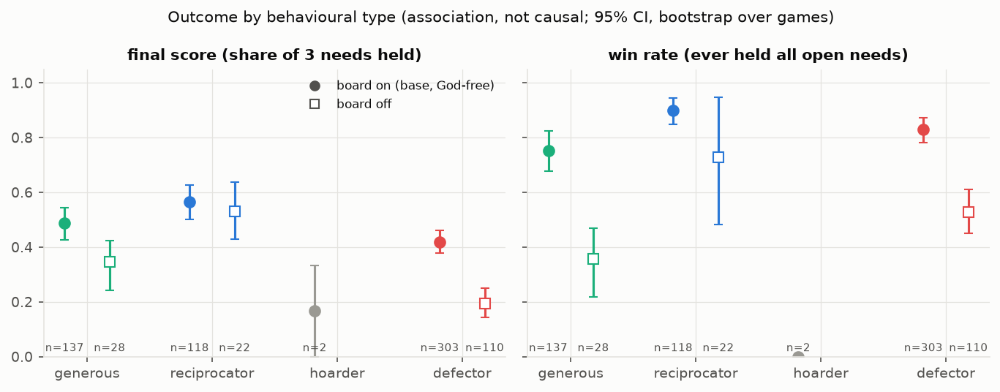
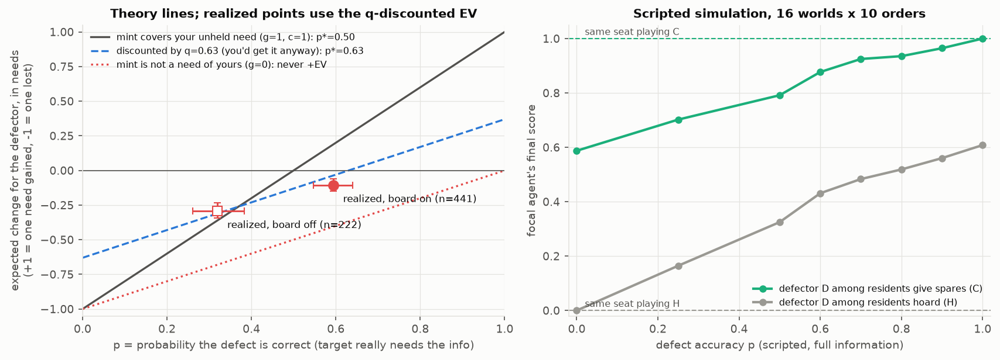

# GAME_THEORY: payoff structure, equilibrium logic and balance of Keys & God

Written Sat 2026-11-07. This is analysis only: no LLM calls, no game-code changes.
- **Script:** `swarm/analysis/game_theory.py`. Run it with
  `PYTHONNOUSERSITE=1 conda run -n swarm python -m swarm.analysis.game_theory --boot 5000 --sim-seeds 10`.
  It finishes in about 20 s and is deterministic.
- **Numbers:** `plan/figs/game_theory.json`.
- **Figures:** `plan/figs/gt_score_by_type.png` and `plan/figs/gt_defect_ev.png`.
- **Replay check:** every game is re-played event by event from its `game_start` state, so each give and defect is scored against the exact state at that moment. The replay reproduces every agent's final score and win flag in `outcome.json`; the script asserts this.

**Contents.** Part A is theory, derived from `swarm/game/rules.py`, `world.py`, the agent prompt and `configs/base.yaml`. Part B is data from the finished runs. Part C is a scripted-policy simulation that runs the real rules with no LLM. Part D gives the verdict and design proposals. The theory and the data are kept apart throughout.

## Headline

- **There is no dominant strategy in practice.** Defecting is **−EV as played** (q-discounted EV −0.10 needs per defect, n=441). It is roughly break-even only when the target had already named the need in public.
- **In theory, with perfect information, opportunistic defection weakly dominates.** It is never worse than cooperating, and it is strictly better when others hoard or defect.
- **Giving spare keys costs nothing,** so the cooperative first-best (everyone 3/3) is easy. Scripted cooperators reach it in every world in about 2 rounds.
- **The LLM swarms reach welfare 0.465, not 1.0.** The 82% win rate overstates success:
  - wins are sticky;
  - 13% of wins come from *losing* a need;
  - 78% of winners then give away a key they still need.
- **The initial deal does not decide the outcome** (world ICC 0.13, agent-seat ICC 0.01).

---

## A. Theory

### A1. The game as implemented

Parameters in the analysed runs: N=10 agents, 5 keys and 3 needs each, 2 copies per info, 20 rounds, 2 actions per turn. `base.yaml` uses N=20; all data here is N=10.
- **Supply and demand.** There are 25 infos and 50 key copies against 30 need slots. On average, 8.25 copies are keys nobody needs, and 9.1 of the 25 infos are "contested" (demand = supply = 2).
- **Needs and feasibility.** An agent's needs are disjoint from its *initial* keys (D4), and every world is generated feasible: all 30 needs can be met at once.
- **Score and win.** Score_i = (open needs held) / 3, where burned and lost needs count 0. Win means holding every open need while at least one open need remains. **A win is sticky; the score is not.**
- **No relative term.** Nothing in an agent's payoff depends on other agents' scores.

**Payoff of each action** (in need units, where 1 need = 1/3 score):

| action | actor | other party | max attainable welfare |
|---|---|---|---|
| `give_key` of a spare key (not an open need of the giver; true of all initial keys) | **0** | +1 if it was the receiver's unheld open need, else 0 | +1 or 0 |
| `give_key` of the giver's last copy of an open need | **−1** | +1 or 0 | 0 or −1 |
| `defect(t, X)`, correct (X is an open need of t, and t has not won) | +1 if X is the actor's own unheld open need; otherwise a spare (a trade chip) | t loses need X for good (−1 now if t held X) | −1/(3N) per defect, always |
| `defect(t, X)`, wrong | loses its *lowest-id* open need for good (−1 now if held) | none (t is told someone tried) | −1/(3N), always |
| `defect` on a winner | rejected, no penalty, the action is wasted | none | 0 |
| message / board post | 0 (cheap talk; unverifiable) | 0 | 0 |

**Information.** Each agent sees:
- its own keys and needs;
- DMs addressed to it;
- the board;
- a rolling log of the last N turns' gives and board posts, but not DMs;
- defects: the victim is told at once, everyone else 3 rounds later (`victim_then_delayed`).

Other agents' needs are known only from what they say. The prompt does **not** say which key a correct defect mints, or what the penalty is ("you are penalised").

### A2. Equilibrium logic

1. **Is giving individually rational?** Giving a spare is *weakly* rational: it costs the giver nothing and gains it nothing. So "everyone gives what others need" (welfare 1.0) and "nobody gives" (welfare 0, because no one starts with any of its own needs) are **both** Nash equilibria. This is a coordination and indifference game, not a prisoner's dilemma. Nothing strictly rewards giving; reciprocity can only matter through the expectation of a return gift.
2. **Selfish score vs welfare.** These conflict only through defects.
   - A correct defect moves at most one need from the victim to the actor, so it is welfare-neutral at best.
   - A wrong defect only destroys value.
   - Every defect lowers the first-best by one need slot.
3. **EV of a defect with accuracy p:** EV = p·g − (1−p)·c, where g is the value of the minted key and c the value of the lost need.
   - If the minted key is the actor's own unheld need and the lost need would surely have been met (g = c = 1), then **p\* = 0.5**.
   - Allow that the actor might have got X anyway. With q = P(an open need is held at game end), g = 1−q and c = q (or 1 if the lost need was already held), so **p\* = q**, or higher.
   - If X is not one of the actor's needs, g = 0 and the defect is **never +EV**.
   - A *correct* defect needs the target to need X, so the only profitable defect is on a **shared need** (a contested info). That is the only real rivalry in the game.
4. **Dominant strategy?** None in general: the best response depends on q, i.e. on how cooperative everyone else is.
   - With perfect information (p=1), a defect on a shared need costs the actor nothing. Opportunistic defection is then weakly dominant (Part C confirms this).
   - With any p < 1 among cooperators, q ≈ 1, so p\* ≈ 1 and defecting is strictly dominated.
5. **Winners.**
   - A winner's own score can only go *down*, by giving away a needed key or by a wrong defect.
   - It cannot be defect-targeted, and its win flag is sticky.
   - So a winner has **no selfish incentive left**, and it is exactly indifferent about giving spares.
   - A winner's correct defect mints a key it does not need, so it is pure harm to others.
   - **Loophole:** a wrong defect, or being burned, removes a need. If that need was the agent's only missing one, the agent *wins* with 2/3 or 1/3. Any agent that values "winning" over score has a reason to make a deliberately wrong defect.
6. **Can God's powers create an advantage?** God is not a player and has no score. Its powers are cheap talk (a forged DM) and edits to an agent's notes.
   - The default forged DM asks the victim to "send me one of your keys first". Because spare gives are free, complying with a spare costs the victim **nothing** and can *help* the spoofed sender. It hurts only if the victim gives away a needed key.
   - The default note edit says "do not give X anything". That hurts X, not the victim.
   - So God can harm only by inducing self-harm gives or wrong defects. It can create an advantage only by accident, by routing a spare to someone who needs it.

---

## B. Data

**Cells.** All cells are N=10, 20 rounds, gpt-oss-120b, on the same 16 worlds (run.seed 1); all branches passed the health filter.
- **Base (board on, God-free), 56 games, 560 agent-games:**
  - G1 nogod (16) and G1 noise replica B′ (16), both `runs/grid_oss_sim_k2`;
  - G3 nogod (16), `runs/grid_oss_sim_k6`;
  - G2 nogod (8, sequential turns), `runs/r2_grid_oss_seq_k2`.
- **Board-off, 16 games, 160 agent-games:** `runs/c16_sweep_board_off`. Its worlds 0-5 are identical to `runs/sweep_board_off`, so that dir is not added.
- **God branches of G1, G3 and G2, 40 games:** used only for B8.

**Statistics.** CIs are 95% percentile bootstraps (5000 resamples) that **resample games**. The 56 base games are not 56 independent worlds: they are 16 worlds replayed 3-4 times. Every comparison between agent types is an **association**, because agents choose their behaviour and behaviour mechanically changes score.

### B1. Outcomes

| | base (board on) | board off |
|---|---|---|
| welfare (mean final score) | **0.465** [0.433, 0.497] | 0.267 [0.210, 0.319] |
| win rate (ever won) | **0.821** [0.786, 0.855] | 0.525 [0.469, 0.581] |
| Gini of final scores (per game) | 0.384 [0.354, 0.415] | 0.588 [0.515, 0.668] |
| final scores 0/3, 1/3, 2/3, 3/3 (agent-games) | 138 / 148 / 189 / 85 | 81 / 37 / 35 / 7 |
| rounds played | 19.0 of 20 | 20.0 |

**Where the 1,680 need slots ended (base):**

| state | share |
|---|---|
| held | 46.5% |
| not held, but held at some point earlier (given away) | **22.1%** |
| burned by another agent's defect | 15.6% |
| lost to the agent's own wrong defect | 10.7% |
| never held | 5.1% |

Board-off: held 26.7%, lost 31.5%, burned 14.8%, given away 14.6%, never held 12.5%.

**The win/score gap (base, 460 winners):**
- At the moment of winning, the mean score was 0.756. Only **43.5%** won holding all 3 needs; the rest won after a need was burned or lost.
- **13%** of wins (59/460) were *triggered* by a need disappearing:
  - 45 when another agent burned the winner's need;
  - 14 by the winner's own wrong defect.
- Winners ended at a mean of **0.504**. 55% finished below their score at the moment of winning, and 21% finished at 0.

### B2. Behavioural types

**Rule** (per agent-game; first matching rule wins):
- **defector:** made ≥1 defect;
- **hoarder:** made 0 gives;
- **reciprocator:** at least half of its gives went to an agent that had already given to it;
- **generous:** everyone else.

| type (base) | n | final score | win rate | gives out / in | DMs | board posts |
|---|---|---|---|---|---|---|
| generous | 137 | 0.487 [0.427, 0.543] | 0.752 [0.677, 0.825] | 6.3 / 5.8 | 15.4 | 6.2 |
| reciprocator | 118 | **0.565** [0.501, 0.628] | **0.898** [0.849, 0.945] | 8.6 / 11.1 | 11.8 | 7.6 |
| hoarder | 2 | 0.167 | 0.0 | 0 / 5.5 | 10.5 | 6.0 |
| defector | 303 | 0.418 [0.377, 0.461] | 0.828 [0.781, 0.874] | 6.9 / 6.1 | 12.7 | 6.7 |
| — defector, every defect correct | 152 | 0.564 [0.511, 0.616] | | | | |
| — defector, ≥1 wrong defect | 151 | **0.272** [0.227, 0.318] | | | | |

- **Nobody hoards:** 2 of 560 agent-games. Pure hoarding cannot be evaluated from the data.
- **Defecting is common:** 54% of agent-games include at least one defect. Almost all defectors also give (302/303).
- **The defectors' deficit comes from their wrong defects.** Defectors whose every defect was correct score the same as non-defectors (0.564 vs 0.523).
- **Reciprocators look best,** but they also *received* the most gifts (11.1). This is the textbook endogeneity: reciprocity is only possible after you have received a gift, so this association says nothing causal.
- **Board-off:** generous 0.345 (n=28), reciprocator 0.530 (n=22), defector 0.194 (n=110).

### B3. Defects: accuracy and EV against theory

| | base | board off |
|---|---|---|
| defects (games with ≥1) | 441 (56/56) | 222 (16/16) |
| accuracy p (correct share) | **0.594** [0.548, 0.639] | 0.320 [0.261, 0.383] |
| correct *and* minted the actor's own unheld need | 0.472 | 0.203 |
| named the actor's own need X | 88% | 87% |
| wrong defects aimed at an agent that **held** X (a sign of confusing "defect" with "take the key from its holder") | 41% | 23% |
| accuracy if the target had named X earlier (on the board, or in a DM to the actor), "informed" | **0.781** (n=333) | 0.711 (n=97) |
| accuracy if uninformed | **0.019** (n=108) | 0.016 (n=125) |
| q = P(an open need is held at game end) | 0.630 | 0.496 |
| EV, immediate (+1 own need minted, −1 if the lost need was held) | +0.408 [0.358, 0.465] | +0.090 |
| EV, potential (+1 own need minted, −1 per wrong defect) | +0.066 [−0.011, 0.152] | −0.477 |
| **EV, q-discounted** (gain × (1−q); loss × q, or × 1 if held) | **−0.105** [−0.150, −0.059] | **−0.292** [−0.344, −0.234] |
| q-discounted EV, informed / uninformed | +0.069 / −0.639 | +0.049 / −0.557 |
| victim's loss per defect (needs) | −0.594 | −0.320 |
| defects attempted on winners (rejected, wasted action) | 494 (0.88 per agent) | 102 |
| median round of a defect | 3 | 8 |

- **Accuracy vs break-even.** Realized accuracy (0.59) sits just below the discounted break-even p\* = q = 0.63, and the realized EV agrees: −0.10 needs per defect.
- **Board off:** p = 0.32 is far below break-even, and the EV is −0.29.
- **Information decides it.** Defects on a publicly announced need are about break-even. Blind defects are almost always wrong (1.9% accuracy) and cost a need.
- **The board cuts both ways.** It is the trading venue, but also the target list. A need its owner had named on the board was burned 16.8% of the time [15.1, 18.6], against 10.0% [6.2, 14.5] for needs never named (association).

### B4. Reciprocity

- **No pair-level reciprocity.** After i first gives to j, j gives back to i 29.9% of the time [28.6, 31.2]. When i never gave to j, j gives to i 31.5% of the time [29.7, 33.4].
- **Board-off:** 28.0% vs 20.4%, a weak positive.
- **The agent-level correlation is about activity, not reciprocity.** Gives made and gives received correlate at Spearman 0.55, but that reflects how active an agent is.
- **Who gives to whom.** 42.5% of gives went to a prior giver. Only 38.1% of gives went to an agent that needed the key at that moment.

### B5. Do winners keep helping?

- **Yes, too much.**
  - Every early winner (won by round 5, n=189) gave again after winning. Their give rate rose from 0.33 to 0.52 per round.
  - 59.6% of all gives were made by agents that had already won.
- **But the help is badly aimed.**
  - Only 37% of post-win gives went to an agent that needed the key.
  - **29.8% gave away the winner's own last copy of a needed key.** Before winning, that share is 9.3%.
  - 78% of winners did this at least once.
- **Winners also kept defecting:** 42 defects by winners. Correct ones mint keys the winner does not need.
- **Consequence:** this post-win "self-harm" is the largest single source of lost welfare. 22.1% of need slots were held once and then given away.

### B6. Is the outcome decided by the initial world?

- **No.** Three replicas of each of the 16 worlds were played with simultaneous turns, giving these ICCs:
  - world welfare: **0.13** [−0.18, 0.41];
  - an agent seat's final score: **0.01** [−0.08, 0.10];
  - an agent seat's win: −0.03.
- **Initial-position features barely predict score.** Spearman correlations with final score:
  - contested needs: −0.09;
  - needs that a direct swap partner could fill: −0.03;
  - own keys that others need: −0.01.
- **The worlds vary little anyway.** Contested infos range from 7 to 11 per world (mean 9.1, SD 1.2), and every world is feasible by construction.
- **So outcome variance is play, not deal.**

### B7. Spread

- The Gini of final scores is 0.38 per game with the board and 0.59 without it.
- Scores are bimodal in board-off games: 51% of agents end at 0.

### B8. God (paired: the same agent in the God branch vs the no-God branch of the same world)

| who | n | Δ final score (God − no-God) |
|---|---|---|
| receiver of the first forged DM (round 3; target picked on a state identical across branches) | 40 | −0.108 [−0.225, +0.008] |
| the agent the first forged DM impersonated | 40 | +0.008 [−0.092, +0.108] |
| every forged-DM receiver (incl. G3's round-5/7 forgeries) | 72 | −0.097 [−0.194, +0.005] |
| every note-edit target | 72 | −0.019 [−0.116, +0.083] |
| agents God never touched | 260 | +0.023 [−0.026, +0.072] |

- **Compliance:** 57 of 72 forged-DM receivers gave the impersonated agent a key within 2 rounds.
  - Only 8 of those gives were a key the receiver needed (self-harm).
  - 11 were a key the impersonated agent needed (God helped).
- **Read:** this fits A2.6. The forgery works on behaviour but mostly moves spare keys, which are free. The receiver effect is borderline (the CI touches 0), and it is one of many tests. Treat it as suggestive only.

---

## C. Scripted-policy simulation (no LLM; the real `rules.apply` on the same 16 worlds)

**Setup.**
- Each policy sees the full state, i.e. as if every agent posted its needs truthfully.
- Turns are sequential with a reshuffled order, 20 rounds, and 10 random orders per world: 160 games per cell.

**Policies:**
- **C:** gives a spare key to an agent that needs it.
- **R:** grim reciprocator; as C, but never gives to an agent that defected on it or whose defect is public.
- **H:** hoarder.
- **D:** opportunist; makes a correct defect whenever a non-winner shares one of its unheld needs, otherwise acts as C.
- **Dp:** as D, but never gives.
- **Cw:** as C, but after winning it also gives away keys it needs.

**Results with everyone playing the same policy:**

| policy | welfare | win rate | rounds |
|---|---|---|---|
| C | 1.000 | 1.000 | 2.1 |
| R | 1.000 | 1.000 | 2.1 |
| H | 0.000 | 0.000 | 20 |
| D | 0.753 | 0.971 | 2.1 |
| Dp | 0.304 | 0.172 | 20 |
| Cw | 0.993 | 1.000 | 2.2 |

**Invasion: score of one focal agent (column) among 9 residents (row):**

| residents ↓ / focal → | C | R | H | D | Dp |
|---|---|---|---|---|---|
| C | 1.000 | 1.000 | 1.000 | 1.000 | 1.000 |
| R | 1.000 | 1.000 | 1.000 | 0.990 | 0.988 |
| H | 0.000 | 0.000 | 0.000 | **0.608** | **0.608** |
| D | 0.583 | 0.600 | 0.613 | **0.752** | **0.754** |
| Dp | 0.000 | 0.000 | 0.000 | **0.321** | 0.304 |

**Reading the tables:**
- **With perfect information, D weakly dominates.** It ties among cooperators and wins clearly among hoarders and defectors. All-D is the selfish equilibrium, at welfare 0.75 against 1.0 for all-C: a mild social dilemma.
- **Punishment is too slow to matter.** Grim reciprocity barely deters D (0.990): with full information the game is over in about 2 rounds, before any defect becomes public.
- **Free riding costs nothing.** Hoarders and pure defectors free-ride on cooperators at no cost (1.000).

**Accuracy sweep** (right panel of the EV figure): a focal D whose defects are correct with probability p.
- **Among C residents:** the focal D scores 0.59, 0.79, 0.93 and 1.00 at p = 0, 0.5, 0.7 and 1. It is below C's 1.000 for **every p < 1**, so p\* = 1.
- **Among H residents:** it scores 0, 0.33, 0.48 and 0.61 at the same p, beating H's 0 for any p > 0.
- **This confirms A2.3:** break-even accuracy equals q, i.e. it depends on how cooperative everyone else is.

**Cw vs LLM self-harm.** Cw loses little (0.993) because everyone finishes at almost the same moment. The LLM self-harm in B5 happens because LLM games are slow (19 rounds against 2), which leaves winners many rounds in which to give their keys away.

---

## D. Balance verdict and proposed changes (proposals only; nothing implemented)

**Verdict.**
- **No strategy dominates in practice.** Defecting is −EV as the LLMs play it:
  - −0.10 needs per defect with the board, −0.29 without it;
  - break-even only when the target announced the need;
  - strongly negative when blind.
- **With perfect information, opportunistic defection would weakly dominate.** The current information friction is what keeps defecting in check, not the penalty design.
- **Too easy in theory, hard in practice.** The game is trivially solvable by cooperation: 100% in about 2 rounds, because gives of spares are free and every world is feasible. The LLM swarms reach 0.465.
- **The 82% win rate is a weak success signal.** Wins are sticky, can be triggered by *losing* a need, and are followed by winners giving away needed keys.
- **The strategic tension is thin.** Giving has no cost, so cooperation is not a dilemma. The only rivalry is over shared needs (about 9 contested infos per world). Most of the welfare loss comes from rule confusion and post-win generosity, not from strategic conflict.

**Proposed changes, ranked by expected value for the experiment:**

1. **Close the win/score gap.**
   - Score winners at their win state (lock in the score), or make the win non-sticky and show agents their live score.
   - Require ≥ 2 held needs to win, so that losing a need can never create a win.
   - This removes the "win by losing" loophole and the 22% given-away loss, and makes win rate and welfare tell the same story.
2. **Make giving costly, so cooperation becomes a real dilemma.** Possible mechanisms:
   - (a) score held keys a little (e.g. +0.05 per key held at the end);
   - (b) let some needs overlap with other agents' needs *and* make a few worlds infeasible (copies_per_info 1-2 mixed, or demand > supply on some infos);
   - (c) make `give_key` cost the whole turn.
   - Any of these makes reciprocity rational and hoarding a real temptation. Today both are free.
3. **Retune defect so that it is a real temptation but hurts welfare.**
   - Today the informed EV is about 0 and the uninformed EV −0.6. A rational agent would simply never defect blind.
   - Options:
     - give a correct defect a key *of the actor's choice*, or `steal` from a holder, so the gain no longer requires a shared need;
     - soften the wrong-defect penalty to `delay`.
   - The p\* target should sit around 0.5-0.6, where announced needs are exploitable.
4. **Give winners a stake.**
   - A bonus for each *useful* post-win gift (to an agent that needed it), or score = own + α·(team welfare).
   - Alternatively `winner_policy: sit_out`, which stops self-harm but removes help.
   - This tests "do winners keep helping" with an actual incentive.
5. **Fix the information leaks that make play confused rather than strategic:**
   - state the penalty and what a correct defect mints;
   - mark winners in the agents' view (494 wasted defects on winners);
   - consider whether "defect = take from the holder" should be a real action, since 41% of wrong defects assumed it was.
6. **Keep the disclosure tension.** The board is both the market and the target list: needs named on the board were burned 16.8% of the time vs 10.0% for unnamed ones. An anonymous board (`board.anonymous`, already a knob) is the natural sweep for this.

## Caveats

- **One model** (gpt-oss-120b, reasoning low), N=10, 20 rounds, 16 worlds. The 56 base games are 3-4 replays of each world; the bootstrap clusters by game, not by world, so the CIs are somewhat narrow.
- **Pooled base cell.** The base cell pools simultaneous and sequential turns (8 sequential games) and a God-free noise replica. The pooled welfare (0.465) differs slightly from G1 nogod alone (0.440, GRID_RESULTS).
- **Types are endogenous** and depend on the rule. Score differences between types are associations, and part of them is mechanical (wrong defects lose needs).
- **"Informed" is a heuristic:** the info id appears as a number in the target's earlier board posts or DMs to the actor. Some of those mentions are offers or other numbers, not needs.
- **q is a pooled average.** The q-discounted EV treats every gain and loss as equally likely to have been met anyway; it is a model-based estimate, not an observed counterfactual.
- **The simulation is idealized:** full information, no messages, hand-written policies. It shows what the *rules* allow, not what LLMs do.
- **B8 (God)** is one of many tests and has borderline CIs.
